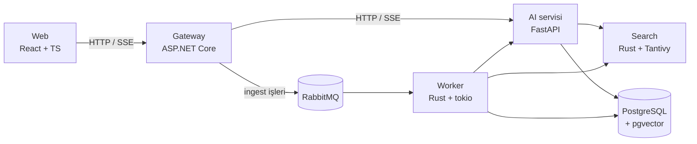

# Quarry

Türkçe dokümanlar için kurumsal RAG (soru-cevap) platformu. Şirketler PDF, Word ve metin dosyalarını
yükler; çalışanlar doğal dilde soru sorar; sistem cevabı kaynak doküman ve sayfa numarasıyla verir.

> Geliştirme aşamasında. Faz planı: [docs/phases.md](docs/phases.md) · Mimari kararlar: [docs/adr](docs/adr)

## Mimari



## Hızlı başlangıç

Gereksinim: Docker (Compose v2) ve bir [OpenRouter](https://openrouter.ai) API anahtarı.

```bash
cp .env.example .env
```

`.env` içinde `OPENROUTER_API_KEY`, `DEV_USER_PASSWORD`, `JWT_SIGNING_KEY` ve `INTERNAL_TOKEN` değerlerini doldur, ardından:

```bash
docker compose up -d --build
```

Uygulama: <http://localhost:8080> — `DEV_USER_EMAIL` / `DEV_USER_PASSWORD` ile giriş yap, `samples/calisan-el-kitabi.pdf`
dosyasını yükle ve "Yıllık izin kaç gün?" gibi bir soru sor.

## Nasıl çalışır (Faz 1)

1. **Yükleme:** Gateway dosyayı doğrular (uzantı + içerik imzası), paylaşılan volume'a kaydeder, `documents`
   tablosuna `pending` olarak yazar ve AI servisinden işlemeyi ister.
2. **İşleme:** AI servisi PDF'ten sayfa sayfa metin çıkarır, Türkçe kurallarla normalize eder, kısaltmaları
   koruyarak cümlelere böler, sayfa sınırını aşmayan örtüşmeli chunk'lar üretir ve `bge-m3` ile embed eder.
3. **Soru-cevap:** Soru embed edilir, kullanıcının tenant'ı içinde pgvector ile en yakın chunk'lar bulunur,
   numaralı kaynaklarla prompt kurulur ve cevap SSE ile akarak gelir. Cevapta atıf yapılan kaynaklar
   doküman adı ve sayfa numarasıyla gösterilir.
4. **Kullanım kaydı:** Her embedding ve LLM çağrısı token ve maliyetiyle `llm_usage` tablosuna yazılır.

## Geliştirme

| Klasör | Teknoloji | Komutlar |
|--------|-----------|----------|
| `gateway/` | .NET 10 | `dotnet test`, `dotnet format --verify-no-changes` |
| `ai/` | Python 3.12, uv | `uv run pytest`, `uv run ruff check .`, `uv run mypy app tests` |
| `web/` | React, TypeScript, Vite | `npm test`, `npm run lint`, `npm run typecheck` |

Tüm testler ve lint: `make test`, `make lint`.
Yeni migration: `make migration name=create_documents`.
