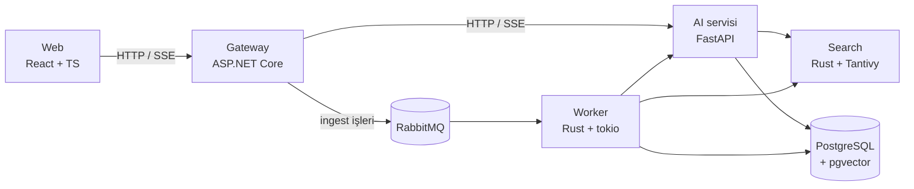

# Quarry

Türkçe dokümanlar için kurumsal RAG (soru-cevap) platformu. Şirketler PDF, Word ve metin dosyalarını
yükler; çalışanlar doğal dilde soru sorar; sistem cevabı kaynak doküman ve sayfa numarasıyla verir.

> Geliştirme aşamasında. Faz planı: [docs/phases.md](docs/phases.md) · Mimari kararlar: [docs/adr](docs/adr)

## Mimari



## Hızlı başlangıç

Gereksinim: Docker (Compose v2).

```bash
cp .env.example .env
docker compose up -d --build
```

Uygulama: <http://localhost:8080>

## Geliştirme

| Klasör | Teknoloji | Komutlar |
|--------|-----------|----------|
| `gateway/` | .NET 10 | `dotnet test`, `dotnet format --verify-no-changes` |
| `ai/` | Python 3.12, uv | `uv run pytest`, `uv run ruff check .`, `uv run mypy app tests` |
| `web/` | React, TypeScript, Vite | `npm test`, `npm run lint`, `npm run typecheck` |

Tüm testler ve lint: `make test`, `make lint`.
Yeni migration: `make migration name=create_documents`.
