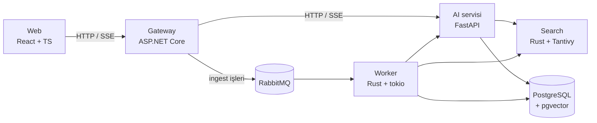
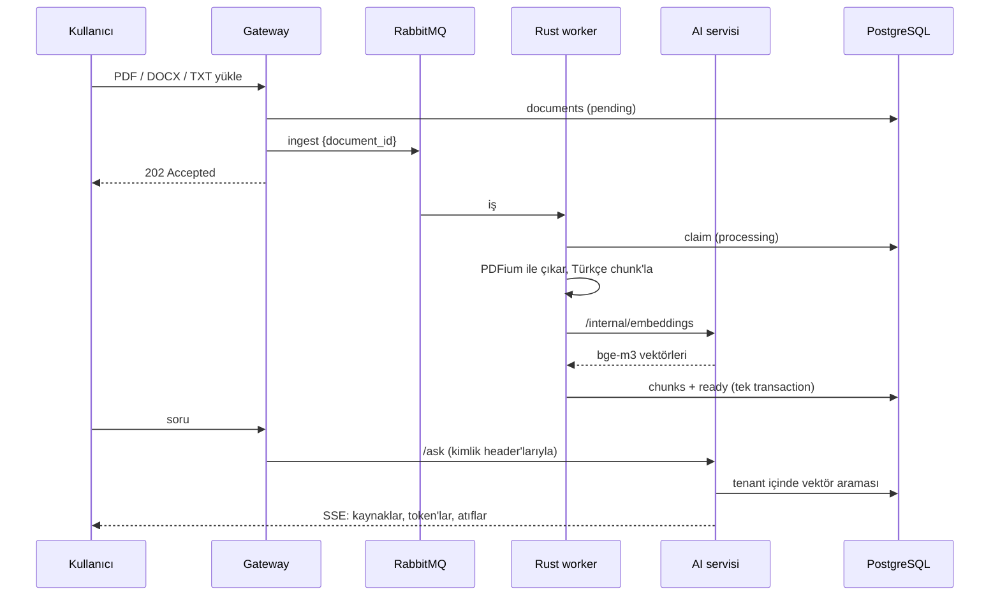

# Quarry

Türkçe dokümanlar için kurumsal RAG (soru-cevap) platformu. Şirketler PDF, Word ve metin dosyalarını
yükler; çalışanlar doğal dilde soru sorar; sistem cevabı kaynak doküman ve sayfa numarasıyla verir.

> Geliştirme aşamasında. Faz planı: [docs/phases.md](docs/phases.md) · Mimari kararlar: [docs/adr](docs/adr)

## Mimari



## Hızlı başlangıç

Gereksinim: Docker (Compose v2) ve bir [OpenRouter](https://openrouter.ai) API anahtarı.

```bash
cp .env.example .env
```

`.env` içinde `OPENROUTER_API_KEY`, `DEV_USER_PASSWORD`, `JWT_SIGNING_KEY`, `INTERNAL_TOKEN` ve `RABBITMQ_PASSWORD`
değerlerini doldur, ardından:

```bash
docker compose up -d --build
```

Uygulama: <http://localhost:8080> — `DEV_USER_EMAIL` / `DEV_USER_PASSWORD` ile giriş yap, `samples/calisan-el-kitabi.pdf`
dosyasını yükle ve "Yıllık izin kaç gün?" gibi bir soru sor.

## Nasıl çalışır



1. **Yükleme:** Gateway dosyayı doğrular (uzantı + içerik imzası), paylaşılan volume'a kaydeder, `documents`
   tablosuna `pending` olarak yazar ve RabbitMQ'ya kalıcı bir iş mesajı bırakır (publisher confirm ile).
2. **İşleme (Rust worker):** `tokio` ile eşzamanlı iş tüketir. PDF'i PDFium ile, DOCX'i XML'den sayfa sonlarıyla
   okur; Türkçe kurallarla normalize eder (`I→ı`, `İ→i`, kısaltmalar, tire ile bölünmüş satırlar), tablo
   satırlarını ayrı tutar ve sayfa sınırını aşmayan örtüşmeli chunk'lar üretir. Embedding'i AI servisinden ister.
3. **Hata yönetimi:** Geçici hatalar (AI servisi/sağlayıcı kapalı, veritabanı) `ingest.retry` kuyruğunda 30 sn
   bekleyip en fazla 5 kez tekrar denenir; kalıcı hatalar (bozuk dosya) ve tükenen denemeler `ingest.dead`'e düşer.
   Aynı mesajın iki kez gelmesi sonucu değiştirmez (idempotent claim).
4. **Soru-cevap:** Soru embed edilir, kullanıcının tenant'ı içinde pgvector ile en yakın chunk'lar bulunur,
   numaralı kaynaklarla prompt kurulur ve cevap SSE ile akarak gelir. Atıf yapılan kaynaklar doküman adı ve
   sayfa numarasıyla gösterilir.
5. **Kullanım kaydı:** Her embedding ve LLM çağrısı token ve maliyetiyle `llm_usage` tablosuna yazılır.

## Chunking benchmark'ı: Python vs Rust

Aynı algoritma iki dilde uygulanır; eşitlik `fixtures/chunking/cases.json` ile her iki tarafın testlerinde ve
benchmark'ta çıktıların SHA-256 özetiyle doğrulanır. Ölçülen yalnızca chunking süresidir (dosya okuma ve
süreç açılışı hariç); bellek, sürecin tepe RSS değeridir (girdinin belleğe yüklenmesi dahil).

Makine: Darwin arm64, 3.12.15 (CPython). Her ölçüm 5 çalıştırmanın medyanı.

| Girdi | Chunk | Python süre | Rust süre | Hızlanma | Python bellek | Rust bellek | Çıktı aynı |
|---|---|---|---|---|---|---|---|
| 1 MB | 1,178 | 0.103 s | 0.026 s | **3.9x** | 29 MB | 8 MB | ✅ |
| 10 MB | 11,770 | 1.064 s | 0.255 s | **4.2x** | 100 MB | 40 MB | ✅ |
| 50 MB | 58,844 | 5.381 s | 1.264 s | **4.3x** | 322 MB | 182 MB | ✅ |

**Yorum:** Rust ~4x daha hızlı ve 1.8–3.6x daha az bellek kullanıyor. Hızlanmanın "100x" değil 4x olması
beklenen bir sonuç: algoritmanın ağırlığı regex eşleştirmede ve Python'un `re` modülü zaten C ile yazılmış.
Rust'ın asıl kazancı Python nesnelerinin bellek yükünün olmaması ve worker'da GIL olmadan gerçek paralellik.
Embedding ağ çağrısı uçtan uca sürenin çoğunu oluşturduğu için bu fark doküman başına milisaniyeler düzeyinde
kalır; büyük toplu yüklemelerde ve bellek kısıtlı sunucuda anlamlı hale gelir.

Tekrar üretmek için: `make bench`

## Geliştirme

| Klasör | Teknoloji | Komutlar |
|--------|-----------|----------|
| `gateway/` | .NET 10 | `dotnet test`, `dotnet format --verify-no-changes` |
| `ai/` | Python 3.12, uv | `uv run pytest`, `uv run ruff check .`, `uv run mypy app tests scripts` |
| `web/` | React, TypeScript, Vite | `npm test`, `npm run lint`, `npm run typecheck` |
| `rust/` | Rust (tokio, lapin, sqlx, PDFium) | `cargo test`, `cargo clippy --all-targets -- -D warnings`, `cargo fmt --check` |

Tüm testler ve lint: `make test`, `make lint`.
Yeni migration: `make migration name=create_documents`.
Chunking fixture'larını yeniden üret: `make fixtures`.
RabbitMQ yönetim arayüzü (dev): `docker compose -f docker-compose.yml -f docker-compose.dev.yml up -d` → <http://localhost:15672>
